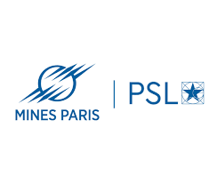

# RmGPT: Foundation Model for Rotating Machinery Fault Diagnosis and Prognosis

RmGPT is a unified foundation model for fault diagnosis and prognosis in rotating machinery. Instead of training a separate network for each machine or operating condition, RmGPT uses one set of parameters to learn from heterogeneous vibration signals and to adapt to new datasets, fault modes, diagnosis tasks, and remaining-useful-life prediction tasks.

## Overview

Rotating-machinery monitoring systems encounter varying sampling rates, channel configurations, signal lengths, machine types, and health conditions. RmGPT addresses this heterogeneity with a generative time-series foundation model and prompt-based adaptation.

**Key features**

- Unified diagnosis and prognosis with a single backbone.
- Generative pre-training on diverse unlabeled rotating-machinery signals.
- Prompt learning for parameter-efficient adaptation to new tasks and datasets.
- Strong few-shot behavior, including 82.46 percent accuracy in the 16-class CWRU one-shot setting.
- Comparisons against representative CNN, LSTM, Transformer, and fault-diagnosis baselines.

## Architecture

RmGPT combines signal-specific tokenization with task-aware prompts. The input waveform is divided into overlapping patches, each patch is embedded as a signal token, and a two-stage channel-time attention module models both cross-channel dependencies and temporal context.

    Raw multi-channel signal
          |
          v
    Patch-based signal tokenizer
          |
          v
    Channel-time attention encoder
          |
          +------------------+
          |                  |
          v                  v
    Generative pre-training    Task prompts and heads
    next signal token          diagnosis / prognosis

Four token families support the framework:

1. **Signal tokens** capture local waveform structure and global degradation trends.
2. **Prompt tokens** provide task- and dataset-specific adaptation context.
3. **Time-frequency task tokens** represent health semantics for diagnosis and prognosis.
4. **Fault tokens** store prototype-level information for different fault categories.

### Method Highlights

- **Patch-based tokenizer** converts variable-length signals into manageable token sequences.
- **Channel-time attention** processes multi-channel vibration signals in two complementary stages.
- **Generative pre-training** predicts future signal tokens and learns robust representations without labels.
- **Prompt learning** updates fewer than five percent of the total parameters during efficient adaptation.

## Performance

### Main Results

| Task | Dataset | RmGPT-Prompt | RmGPT-Finetune | Best Baseline |
|---|---|---:|---:|---:|
| Diagnosis | CWRU | 99.92% | **100.00%** | 100.00% |
| Diagnosis | QPZZ | **100.00%** | **100.00%** | 100.00% |
| Diagnosis | SLIET | 98.05% | **99.02%** | 98.33% |
| Diagnosis | SMU | 99.11% | **100.00%** | 98.02% |
| Prognosis | XJTU | 0.150 MAE | **0.136 MAE** | 0.158 MAE |

### Few-Shot Learning Performance on CWRU

| Training Samples | RmGPT-Prompt | Best Baseline |
|---|---:|---:|
| 1-shot (16 samples) | **82.46%** | 21.47% |
| 4-shot (64 samples) | **98.53%** | 55.36% |
| 8-shot (128 samples) | **99.27%** | 95.08% |

## Getting Started

### Requirements

The experiments require Python 3.8 or newer and a CUDA-enabled PyTorch installation. Install PyTorch from the [official installation instructions](https://pytorch.org/get-started/locally/) for your CUDA version, then install the remaining pinned dependencies:

    git clone https://github.com/OpenTSLab/RmGPT.git
    cd RmGPT
    pip install -r requirements.txt

The supplied scripts run from the repository root. Set CUDA_VISIBLE_DEVICES according to the GPUs available on your machine.

### Dataset Layout

Place datasets under datasets/PHM_dataset/ with the exact folder names used by the checked-in task configurations:

    datasets/
      PHM_dataset/
        CWRU/
        QPZZ/
        SLIET/
        SMU/
        XJTU_RUL_NEW/
        PHM_Challenge2024/

The model has been evaluated on Case Western Reserve University bearing data, the QPZZ-II gear dataset, the SLIET bearing dataset, SMU gear data, the XJTU bearing-run-to-failure dataset, and PHM Challenge 2024 data. Follow the source datasets' licenses and access conditions.

### Training and Evaluation

Pre-train the RmGPT backbone:

    bash scripts/pretrain_prompt_learning/RmGPT_pretrain_x128.sh

Run supervised diagnosis and prognosis training:

    bash scripts/supervised_learning/RmGPT_supervised.sh

Run prompt tuning and full fine-tuning in the new-dataset few-shot setting:

    bash scripts/few_shot_newdata/RmGPT_prompt_tuning_few_shot.sh
    bash scripts/few_shot_newdata/RmGPT_train_few_shot.sh

Reproduce baseline comparisons with the scripts under scripts/baseline_exp/, for example:

    bash scripts/baseline_exp/ResNet1D_supervised.sh
    bash scripts/baseline_exp/Transformer_supervised.sh

Evaluate a prepared checkpoint on PHM Challenge 2024 data:

    python phm_challenge_test.py \
      --task_data_config_path data_provider/data_config/PHM_competition/PHMchallenge_test.yaml \
      --model RmGPT \
      --model_id phm2024_test \
      --d_model 512 \
      --e_layers 4 \
      --patch_len 256 \
      --stride 256 \
      --pretrained_weight checkpoints/<your_checkpoint>/pretrain_checkpoint.pth \
      --device cuda:0

hyper_search.sh contains the repository-side entry point used for W&B sweeps. Replace its sweep identifier and GPU list before using it in your environment.

Checkpoints are not redistributed in the source-only v1.0 release. The scripts write experiment outputs under checkpoints/; update the checkpoint arguments to point to artifacts produced by your own runs.

## Project Structure

    .
    |-- run.py                         # Supervised training, prompt tuning, and evaluation
    |-- run_pretrain.py                # Generative pre-training
    |-- phm_challenge_test.py          # PHM Challenge 2024 inference entry point
    |-- models/                        # RmGPT and baseline model implementations
    |-- exp/                           # Experiment drivers for training and testing
    |-- data_provider/                 # Dataset loaders and task-configuration YAML files
    |-- utils/                         # Metrics, losses, distributed helpers, and tools
    |-- scripts/                       # Reproduction and baseline launch scripts
    |-- PHM2024_challenge_result/      # PHM Challenge 2024 result-analysis notebook
    |-- requirements.txt               # Python package versions
    +-- LICENSE                        # MIT license

## Contributing

Issues and pull requests are welcome. For substantial changes, please open an issue first to describe the proposed modification, the datasets involved, and the evaluation protocol.

## Citation

If you use RmGPT in research, please cite the project:

    @misc{wang2025rmgpt,
      title        = {RmGPT: A Foundation Model with Generative Pre-trained Transformer
                      for Fault Diagnosis and Prognosis in Rotating Machinery},
      author       = {Wang, Yilin and Yu, Yifei and Sun, Kong and Lei, Peixuan and
                      Zhang, Yuxuan and Zio, Enrico and Xia, Aiguo and Li, Yuanxiang},
      year         = {2025},
      howpublished = {\url{https://github.com/OpenTSLab/RmGPT}}
    }

## License

This project is released under the MIT License. See [LICENSE](LICENSE) for details.

## Acknowledgments

This work was partially supported by:

- National Natural Science Foundation of China (Grant No. 62371297).
- Shanghai Engineering Research Center of Civil Aircraft Health Monitoring (Grant No. GCZX202204).
- iRel40 European co-funded innovation project (Grant No. 876659).

## Contact and Affiliations

  
  
  
  

- **Shanghai Jiao Tong University:** Yuanxiang Li (corresponding author, yuanxli@sjtu.edu.cn), Yilin Wang, Yifei Yu, Kong Sun, and Peixuan Lei.
- **MINES Paris - PSL:** Enrico Zio.
- **Politecnico di Milano:** Enrico Zio.
- **Shanghai Innovation Institute:** Yilin Wang (pandalin@sjtu.edu.cn).

For implementation questions and bug reports, please open a GitHub issue.

## Availability

- **Code:** [OpenTSLab/RmGPT](https://github.com/OpenTSLab/RmGPT), v1.0.
- **Issues:** [GitHub issue tracker](https://github.com/OpenTSLab/RmGPT/issues).

This repository contains research code. Validate the model and evaluation pipeline thoroughly before deploying it to a safety-critical production system.
